# GM Notes 中文使用指南

> **本 fork 说明**：这是 [nachoijp/owlbear-gm-notes](https://github.com/nachoijp/owlbear-gm-notes) 的汉化分支，新增**简体中文**界面（安装后：设置 → 语言 → 中文）。原西班牙语与英语完整保留，默认语言仍为英语，每个玩家各自记忆。
>
> 🌍 English manual: [README.en.md](README.en.md)（原版完整手册）
>
> **安装地址（自托管）**：`https://env-00jy6try6vgy-static.normal.cloudstatic.cn/GMnotesCN/manifest.json`
>
> 本分支新增**简体中文**界面：安装后打开 GM Notes → **设置 → 语言 → 中文**即可切换。界面、内置模板与示例笔记会整体切换，原西班牙语与英语完整保留，默认语言仍为英语，每个玩家各自记忆。

一个 [Owlbear Rodeo](https://www.owlbear.rodeo/) 扩展：为 GM 提供私密的富文本跑团日志，并可将你选定的笔记共享给玩家阅读。

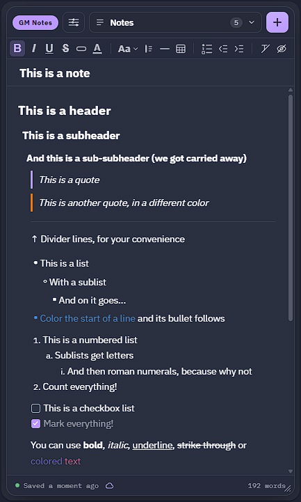

## 安装

在枭熊房间的「添加扩展」中填入 manifest 地址。本汉化版需自行部署后使用你自己的地址（见下方「部署」），原版地址为：

```
https://notes.ijpedraza.com/manifest.json
```

### 部署（汉化 fork 自行托管）

1. 构建前修改 `public/manifest.json` 中的 3 个 URL（`icon`、`background_url`、`action.popover`）为你的托管地址（`background_url` 精确到 `…/background.html`，`popover` 到目录根）；
2. 执行 `npx vite build --base=<你的托管URL>/`；
3. 将 `dist/` 目录下的**全部内容**上传到静态托管；
4. 安装地址即 `https://<你的托管>/<子目录>/manifest.json`。

## 功能一览

- **富文本**：加粗、斜体、下划线、删除线、三级标题、彩色色丸、文字颜色、彩色引用、分隔线、无序/有序列表（缩进即可产生子列表）。给列表项开头上色，其项目符号或编号会跟着变色。
- **Markdown 快捷输入**：在行首输入 `- `（或 `* `）生成无序列表、`1. ` 生成有序列表、`[] ` 生成清单、`# ` 到 `#### ` 生成标题（`#### ` 是折叠块）、`> ` 生成引用、`---` 回车生成分隔线。紧跟 Ctrl+Z 可以撤回格式化、保留纯文本。
- **清单（Checklist）**：在列表菜单选**清单**，每一项前出现方框；点击即勾选（变灰）。玩家在共享笔记里同样能看到，可编辑的笔记里也能勾选。
- **表格**：表头行与表头列、单元格着色、单元格合并、列宽拖拽调整、行列可拖动排序——详见[表格](#表格)。
- **可折叠区块**：折叠任意标题即可隐藏其下内容，还可以用折叠块把细节藏进看似普通的正文——详见[可折叠区块](#可折叠区块)。
- **每个房间多篇笔记**，支持搜索与快速切换。常用的笔记可**置顶**，其余按最近修改或 A–Z 排序。每篇笔记的 **⋯** 菜单可以复制、存为模板或导出。
- **回收站**：删除的笔记进入笔记列表底部的回收站，保留 30 天，可还原或彻底删除。开启云端同步后，回收站也会跟随你到其他设备。
- **与玩家共享笔记**：将任意笔记设为公开，玩家即可实时阅读（不能编辑），且自动剔除你隐藏的部分——详见[与玩家共享笔记](#与玩家共享笔记)。
- **笔记与地图物件互链**：输入 `[[` 链接到其他笔记，或右键地图上的物件为其关联笔记——详见[笔记与地图物件的链接](#笔记与地图物件的链接)。
- **模板**：从现成版式开始写，而不是空白页——详见[模板](#模板)。
- **笔记间复制粘贴**保留全部格式——色丸、颜色、标题、列表、引用原样携带。
- **从任意来源粘贴**：其他应用的文本会干净地进入笔记，不带杂乱字体颜色，且能识别 Markdown——标题、`**加粗**`/`*斜体*`、列表、`- [ ]` 清单、`> 引用`、`---` 分隔线和表格都会直接呈现为样式，而非原始符号。
- **导出与导入**：把一篇（或全部）笔记存为文件，随时导回。选 JSON 可完整还原一切，选 Markdown 则得到可在别处阅读编辑的纯文本副本。
- 每位玩家各自的主题色与语言（中文 / English / Español）。
- 面板大小可调：拖动角落手柄，双击恢复默认尺寸。

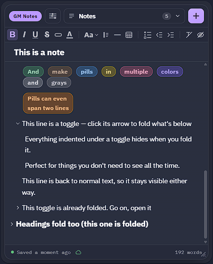

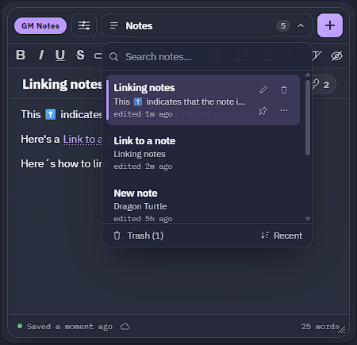

## 可折叠区块

长笔记保持清晰可扫读：点击任意标题旁的箭头（或把光标放进去按 **Ctrl+Enter**），即可折叠其下直到同级或更高级标题之前的全部内容。把整章折叠起来只看大纲，跑团时再展开需要的部分。

- 在工具栏的块类型菜单中选择：**正文**、**标题 1–3** 或 **折叠块**。
- **折叠块**外观与正文完全一样，但会折叠其下方的行——适合放秘密细节、怪物数据、或只在念到时才展开的朗读文本。
- 要在折叠块或标题之外继续书写，对该行使用**减少缩进**（或 **Shift+Tab**）：每次退出一层区块；**增加缩进**（或 **Tab**）则放回去。
- 每一行会随所在层级略微缩进，一眼就能看出它属于哪个标题或折叠块。
- 折叠/展开不算编辑笔记：不会把它顶到列表最上方。


## 表格

从工具栏的表格按钮插入表格，在网格中选尺寸。把光标放进单元格后再点同一按钮，打开表格菜单，其余功能都在里面：

- **表头**：把第一行、第一列或两者设为表头。
- **颜色**：给单个单元格、一整行或一整列上色。
- **合并与拆分**单元格，向右或向下。
- **移动行列**：拖动行左侧或列上方的圆点，或使用 **Alt+Shift+方向键**。
- **列宽**：拖动列边界调整，双击边界则自动适应文字。菜单里还能均分列宽、让所有列适应内容、或让表格适应面板。
- 超出面板宽度的表格会横向滚动，边缘会显示为被切断的样子，提示还有内容。


## 笔记与地图物件的链接

- **链接到其他笔记**：在笔记中任意位置输入 `[[`，从列表中选择（输入可过滤；↑/↓ 加回车，或直接点击）。链接显示目标笔记的当前标题，重命名后也会跟着更新。点击即打开那篇笔记（Ctrl+点击 立即打开）。指向已彻底删除笔记的链接会变灰。
- **玩家**可以点击指向已共享笔记的链接；指向私有笔记的链接对玩家显示为纯文本，因此绝不会指向他们看不到的内容。
- **把笔记关联到地图物件**：右键地图上的任意物件（token、门、标记…）选**链接笔记**，再挑选笔记。此后同一菜单中的**打开笔记**即可直达。选中多个物件可以一次性全部关联到同一篇笔记。
- **笔记的关联**：标题末尾的小按钮显示有多少地图物件和笔记链接到它。点击查看：点物件可在地图上选中它（× 取消关联），点笔记则打开。被彻底删除的笔记会自动解除与物件的关联。**设置 → 物件关联** 可以移除右键菜单入口（已有关联保留）。以上仅 GM 可见。

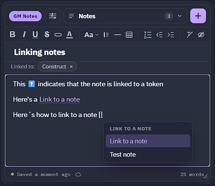

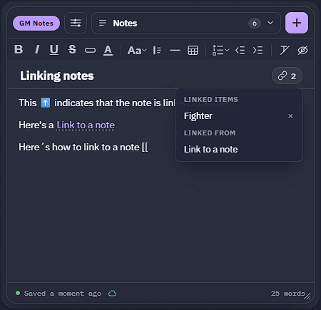

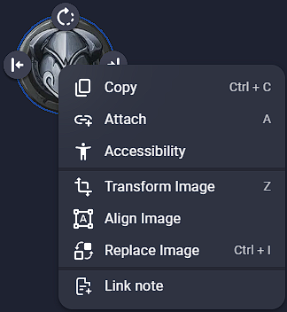

## 模板

**+** 按钮可以从空白笔记或模板开始，让反复出现的笔记——NPC、地点、下次团的开团计划——一上来就有现成的结构。

- **内置模板开箱即用**：NPC、地点、团前准备、团后回顾，以及 D&D 5e 怪物和 Daggerheart 敌手/环境的空白数据卡——还有**「这是一篇笔记」**，一篇快速演示全部格式功能的笔记，看完即可删除。模板跟随你选择的语言显示，从模板创建的笔记从此保持那一刻的语言。
- **自制模板**：把任意笔记按你的喜好排好，在笔记列表该行点击模板按钮保存为模板。
- 在 **+** 菜单里可以**重命名或删除**模板。误删了内置模板？同一菜单底部的**恢复默认模板**可以找回。
- 模板在**所有房间**通用，不限于创建它的房间。「导出全部」会包含模板，登录后它们也会随笔记跨设备同步。


## 与玩家共享笔记

任何笔记都可以共享给玩家：仅供阅读，或允许他们一起编辑。共享需要先登录（设置 → 云端同步），因为共享笔记存储在云端供玩家访问。

- **共享一篇笔记**：打开它，点击左上角的 **GM Notes** 色丸，弹出三选一菜单：
  - **私有**：只有你能看到（所有笔记初始状态）。
  - **可见**：玩家可以阅读。色丸变绿显示**可见**，笔记列表中出现绿点。
  - **公开**：玩家可以阅读并编辑。色丸变橙显示**公开**，圆点为橙色。

  提高共享级别时会先确认；收回共享级别（改回可见或私有）不会。
- **玩家看到什么**：玩家打开 GM Notes 只能看到共享笔记，没有别的。他们可以挑选、搜索、折叠章节。可见笔记是只读的：没有工具栏。两种模式下都没有 **+** 按钮，玩家无法创建自己的笔记。设置里他们只有语言、主题色和手册。
- **你的修改实时到达**：可见笔记约 15 秒内，公开笔记立即。
- **隐藏部分内容**：悬停某一行点击边缘出现的小眼睛，或选中一行或多行后点工具栏最后的眼睛按钮。每一行独立隐藏（一个段落、一个标题、一个列表项），玩家完全看不到：它在共享前就被剔除了。隐藏的行显示在深色框中（连续隐藏的行共用一个），每行有自己的眼睛：点击重新显示该行（Ctrl+Z 可撤销）。如果你希望正文旁的小眼睛忽略点击，可在**设置 → 隐藏部分**锁定。公开笔记中隐藏内容会立即从玩家侧移除；但先写后藏的内容在被隐藏前是可见的，所以请**先隐藏再书写**。从隐藏行新起的行也会被隐藏。共享时确认框会说明该笔记有几处隐藏部分。
- **Markdown 中的隐藏部分**：位于 `<!-- hidden -->` 与 `<!-- /hidden -->` 行之间，Markdown 查看器不会显示它们；隐藏的列表项以 `<!-- hidden -->` 结尾。导出会写入，导入或粘贴会读回（`<!-- oculto -->` 也兼容）。
- **停止共享**：在色丸菜单选**私有**。删除一篇已共享的笔记同样会让玩家看不到它。
- **重新生成密钥**（设置 → 共享笔记）：玩家通过房间中保存的密钥阅读公开笔记。如果已不在房间的人可能仍持有密钥，重新生成即可：从那一刻起对方看不到任何内容，房间内的玩家毫无察觉。
- **退出登录**时若有共享笔记，会先询问是否下架。退出后无法更新或下架，玩家会继续看到原样，直到你再次登录。

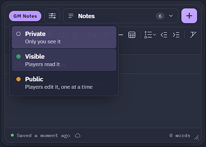

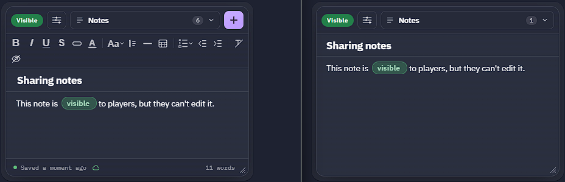

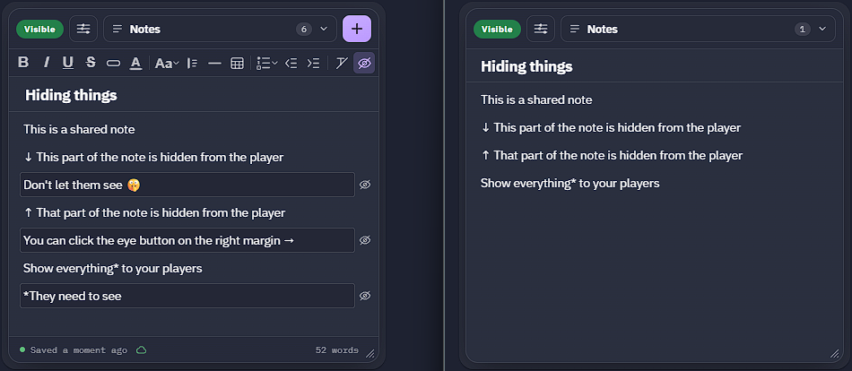

### 玩家可编辑的笔记

**公开**笔记人人可编辑：队伍物资清单、共享日志、他们遇到过的 NPC 列表……

- **同一时间一人编辑。** 谁开始输入谁就持有笔记；其他人（包括你）看到的是只读，底部栏显示正在编辑的人。持有者那里则出现**完成**按钮，点击立即释放。切换到别的笔记、停止输入一分钟（或断线 45 秒）也会自动释放。
- **玩家编辑正文与标题**，工具栏与你相同，但不能隐藏行。他们不能删除笔记、更改共享级别、或关联地图物件。`[[` 列表只提供共享给他们的笔记；指向你私有笔记的链接对他们显示为纯文本。
- **没有隐藏部分。** 设为公开会显示其隐藏行（确认框会说明数量），公开期间无法隐藏。改回可见后可以继续隐藏。
- **他们的修改会进入你的笔记**，其 ⋯ 菜单会出现**撤销玩家的修改**：恢复到你上次编辑之后、他们首次修改之前的版本。你随后自己编辑，会把他们的修改保留为笔记的一部分。
- **编辑公开笔记需要登录**，这样你的修改才能到达玩家。

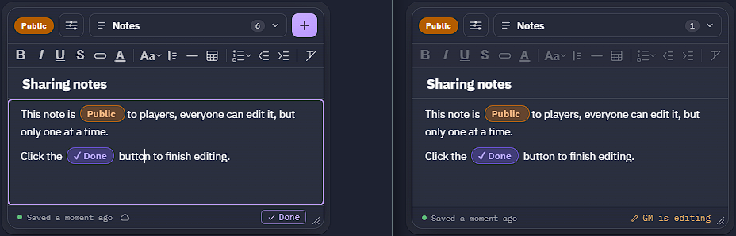

## 笔记保存在你的设备上——可选云端同步

每篇笔记保存在你书写它的设备上。要把笔记带到别处，或只是做个备份，可以导出（或在设置里一次导出全部），在需要的地方导入即可。

想让笔记和模板在多台设备间自动同步？在设置里用 Google 登录即可，它们会在后台同步——除这一次登录外无需任何设置。完全可选，且只有你能看到自己的笔记；登录不会向玩家或其他 GM 共享任何东西。只有你设为公开的笔记才会被共享，且仅限你房间里的玩家。

需要再翻这本手册？设置 → 帮助 → 查看手册 会在新标签页打开。

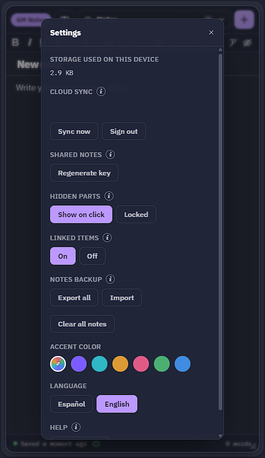

## 支持

发现 bug 或想提功能建议？去上游仓库提 issue：<https://github.com/nachoijp/owlbear-gm-notes/issues>。汉化相关的问题可以在 [SSeiverZIMM/owlbear-gm-notes](https://github.com/SSeiverZIMM/owlbear-gm-notes) 提出。
